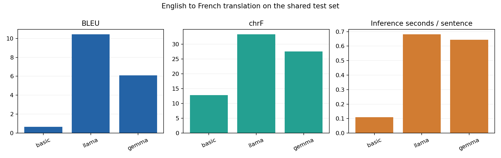
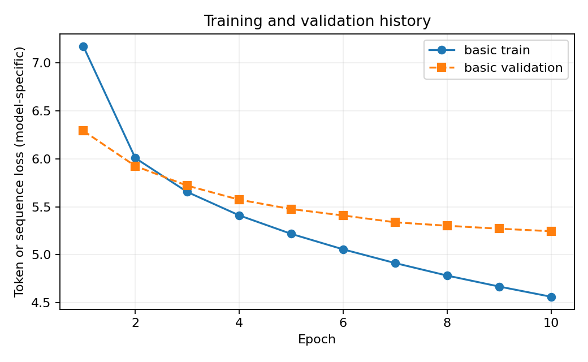

# English to French Machine Translation Comparison

**Harish Bharathwaj | 230953594 | ICT4403 Foundations of Generative AI Assignment 3**

## Result and evidence status

Three systems have saved, validated 200-item test outputs: Basic Transformer, Llama 3.2 1B Instruct, and Gemma 3 270M IT. mT5-small was fine-tuned for two epochs, but generation raised `ValueError: mT5 emitted a sentinel token despite suppression`. It has no valid 200-item translation file, BLEU, chrF, or inference timing. Llama ranks first by the recorded BLEU and chrF scores **among the three completed systems**; no four-model winner can be claimed.

The backup combines completed-model artifacts from an earlier run with a later mT5-only failure status. The 200 source/reference rows in all three completed translation files are identical. Reconstructing the test CSV gives SHA-256 `8637ba500e2a1b7424a208993427fb431237a6c4f9ab28a2b80853a678f2c1b8`, matching the saved split hash. The original mT5-only status is preserved as `mt5_attempt_run_status.json`; `run_status.json` identifies this reconciled submission.

## Dataset and methodology

The code uses the public [OPUS Books English-French parallel corpus](https://huggingface.co/datasets/Helsinki-NLP/opus_books). It normalizes Unicode and whitespace, filters sentence lengths, removes duplicate pairs, shuffles with seed 42, and specifies **4,000 training, 400 validation, and 200 held-out test pairs**. All completed models used the same 200 test pairs, verified by row equality and the test-split hash. The original train/validation CSVs and dataset manifest were not in the backup, so their contents and counts cannot be independently rechecked here.

The Basic model is a two-layer PyTorch encoder-decoder Transformer (width 128, four heads) trained from scratch for 10 epochs. mT5-small received rank-8 LoRA adaptation for two epochs in FP32; its finite training history does not establish successful translation. Llama and Gemma were prompted zero-shot without task-specific training. Primary decoding was greedy with a 64-new-token cap. The mT5 path applied sentinel and repetition controls; causal models used a chat prompt with a plain-prompt retry for empty responses. These decoding and adaptation differences limit architecture-only interpretation.

## Measured comparison

| System | Status | BLEU | chrF | Train time (s) | Inference total (s) | Inference / sentence (s) | Parameters |
|---|---|---:|---:|---:|---:|---:|---:|
| Basic Transformer | Completed | 0.665 | 12.834 | 28.04 | 23.29 | 0.116 | 4,698,250 |
| mT5-small with LoRA | Failed during generation | - | - | Not recorded | - | - | Not recorded |
| Llama 3.2 1B Instruct | Completed | 10.439 | 33.333 | N/A (zero-shot) | 136.44 | 0.682 | 1,235,814,400 |
| Gemma 3 270M IT | Completed | 6.103 | 27.482 | N/A (zero-shot) | 128.80 | 0.644 | 268,098,176 |

The archived scores are SacreBLEU values produced by `experiment.py`. This audit verified finite score ranges, exact record counts, shared test rows, timing arithmetic, and diagnostics against the translation files. SacreBLEU was unavailable in the verification environment, so the BLEU and chrF numbers were **not independently recomputed**. Model loading time is excluded from the recorded per-sentence inference time.

**Figure 1.** The archived comparison plot contains only the three completed models. mT5 has no bar because evaluation failed.

The Basic model is smallest (4,698,250 parameters) and fastest (0.116 s/sentence), but its recorded BLEU is 0.665. Llama has the highest recorded BLEU (10.439) and chrF (33.333) at 1,235,814,400 parameters and 0.682 s/sentence. Gemma records BLEU 6.103 and chrF 27.482 at 268,098,176 parameters and 0.644 s/sentence. These are results for this corpus, hardware, prompts, and decoding setup, not general architecture rankings.

## Training evidence and mT5 failure

The Basic training history contains 10 finite epochs; training loss falls from 7.173 to 4.563 and validation loss from 6.292 to 5.246. The mT5 history contains two finite epochs; training loss falls from 7.825 to 5.098 and validation loss from 3.908 to 3.725. mT5 then emitted a sentinel token such as `<extra_id_0>` during generation despite suppression. The code rejected that output and did not create a validated metric or translation artifact. Its training duration and parameter count are absent from the backup's mT5 metrics because no such metrics file exists.

**Figure 2.** The archived training-curve plot shows the completed Basic system only. mT5's finite loss history is described above without implying successful evaluation.

## Saved translation examples

These are verbatim predictions from the shared held-out test items; they are not edited translations.

### Test item 1

**English:** Prudence was standing looking around the place; Marguerite, seated on the sofa, was meditating.

**Reference French:** Prudence, debout, regardait les quelques curiosités de mon salon; Marguerite, assise sur le canapé, réfléchissait.

**Basic Transformer:** le capitaine, était, le capitaine, le capitaine, le capitaine.

**Llama 3.2 1B Instruct:** Prudence était assise sur le canapé, regardant autour de la place. Marguerite, assise sur le sofa, méditait.

**Gemma 3 270M IT:** Prudence était en train de regarder autour de la place; Marguerite, assise sur le canapé, était en méditation.

### Test item 2

**English:** There was a band of brothers!

**Reference French:** Quelle troupe fraternelle.

**Basic Transformer:** il y avait une voix!

**Llama 3.2 1B Instruct:** Il y avait une bande de frères.

**Gemma 3 270M IT:** There was a band of brothers!

### Test item 4

**English:** "You can vouch for it, Francis!"

**Reference French:** -- Vous pouvez vous porter garant du combat, Francis?

**Basic Transformer:** - - - - vous, dit - vous, dit - vous, dit - vous, dit - vous, dit - vous, dit - vous, dit - vous, dit - vous, dit - vous, dit - vous, dit - vous, dit - vous, dit - vous, dit - vous, dit -

**Llama 3.2 1B Instruct:** "Vous pouvez le prouver, Francis!"

**Gemma 3 270M IT:** You can vouch for it, Francis!

## Error analysis and responsible AI

The saved examples expose distinct error patterns. In item 1, the Basic model repeats *le capitaine*; Llama describes Prudence as seated although the English says she was standing; Gemma keeps the two people separate but paraphrases the scene. In item 2, Gemma returns the English sentence unchanged. Across all 200 saved outputs, exact English-source copies occur in 0 Basic, 5 Llama, and 45 Gemma predictions. This is a simple failure indicator, not a full language-quality test. In item 3 of the test set, the French reference includes an extra sentence absent from the English source, showing possible corpus alignment noise that can affect lexical scores.

Named entities, gender, social roles, politeness, and cultural references can be distorted. The Prudence stance change is a concrete role error; it should not be silently accepted in a sensitive translation. Digit checks found 4 sources with digits: all 4 digit sequences changed in Basic outputs and 2 changed in each Llama and Gemma output. For medical, legal, safety, or public-facing text, retain the source, require human review, check names and numbers, flag source-language copying and repetition, and allow correction. BLEU and chrF measure reference overlap, not factual adequacy, bias, or safety. No model-specific claim about untested sensitive content is made.

## Sampling-temperature analysis

The optional study sampled the first **8** shared test items at temperatures 0.2, 0.7, and 1.0. These are exploratory scores on a much smaller sample than the 200-item greedy comparison. The backup contains valid study files for Basic, Llama, and Gemma; mT5 has none.

| Model | Temperature | BLEU on 8 | chrF on 8 | Empty outputs |
|---|---:|---:|---:|---:|
| Basic Transformer | 0.2 | 1.560 | 15.354 | 0 |
| Basic Transformer | 0.7 | 1.470 | 15.799 | 0 |
| Basic Transformer | 1.0 | 1.006 | 17.521 | 0 |
| Llama 3.2 1B Instruct | 0.2 | 17.489 | 40.125 | 0 |
| Llama 3.2 1B Instruct | 0.7 | 14.521 | 37.458 | 0 |
| Llama 3.2 1B Instruct | 1.0 | 9.829 | 31.557 | 0 |
| Gemma 3 270M IT | 0.2 | 13.607 | 35.209 | 0 |
| Gemma 3 270M IT | 0.7 | 6.535 | 32.487 | 0 |
| Gemma 3 270M IT | 1.0 | 7.896 | 32.176 | 0 |

The small sample does not support a stable temperature ranking. Its scores should not be compared directly with the 200-item greedy scores.

## Conclusion and limitations

Llama is the best-performing **completed** model by both recorded lexical metrics on the shared 200-item test set. The Basic model is much smaller and faster but often repetitive; Gemma has 45 exact source copies. Because mT5 failed during generation, the assignment's requested four-model performance comparison remains incomplete. The report and plots do not assign mT5 a translation, score, or inference time. The archive lacks the original split CSVs and manifest, and this audit could not independently rerun SacreBLEU. Results also reflect a small literary subset, possible alignment noise, one T4 run, and differing pretraining and prompting. Human review remains necessary.

## Reproducibility and sources

The source code, requirements, original model metrics and translations, histories, plots, archived mT5 failure status, reconciled status, and validation record are supplied with this report. Test-split SHA-256: `8637ba500e2a1b7424a208993427fb431237a6c4f9ab28a2b80853a678f2c1b8`. Dataset: [Helsinki-NLP OPUS Books](https://huggingface.co/datasets/Helsinki-NLP/opus_books). Model pages: [mT5-small](https://huggingface.co/google/mt5-small), [Llama 3.2 1B Instruct](https://huggingface.co/meta-llama/Llama-3.2-1B-Instruct), [Gemma 3 270M IT](https://huggingface.co/google/gemma-3-270m-it). Repository supplied by the student: [GenAI2](https://github.com/Harish766/GenAI2.git).

